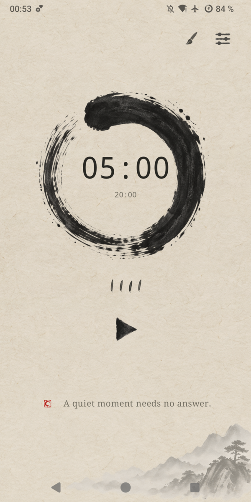

<p align="center">
  
</p>

<h1 align="center">Enso</h1>

<p align="center">A quiet, offline meditation timer and interval gong for Android.</p>

<p align="center">
  <a href="https://github.com/psyke089/enso/releases"></a>
  
  
</p>

<p align="center">
  
</p>

A minimal meditation timer in Kotlin and Jetpack Compose. Android 7.0+ (API 24), portrait-only, entirely offline: no internet permission, accounts, analytics or ads. Behaviour is specified in [SPEC.md](docs/SPEC.md).

## Features

- **Duration by gesture.** Trace the enso clockwise to add time, counterclockwise to remove it: 5 minutes to 24 hours, in adjustable steps of 1, 2, 5, 10 or 15 minutes.
- **Repetitions.** Tap left or right of the circle to subtract or add one; 0 repeats forever. Brush marks below the circle count down as intervals finish, and the circle shows elapsed / total time (or ∞ for unlimited sessions).
- **Paint your own enso.** A full-screen sumi canvas with a tunable brush; saved drawings replace the standard artwork. The canvas opens once per day on its own, and Hardcore Mode offers only the checkmark.
- **Lock-screen timer.** An ongoing notification shows the remaining time and offers pause, resume and stop, so the session survives the phone being put down.
- **Gongs and sayings.** Separate start, end and repeat gongs from nine bundled bells (previewable in Settings), and twenty original sayings that fade in without immediate repeats.
- **Quiet controls.** One calm screen for start, pause, resume, reset; hide the time and saying, disable haptics or keep the screen awake. English and German UI.

## Install

Grab the signed APK from [releases](https://github.com/psyke089/enso/releases) and open it on the phone, or:

```sh
adb install -r enso-1.7.0.apk
```

Release builds are self-signed, so a debug build cannot be installed over one (uninstall first).

## Build

```sh
./gradlew assembleRelease   # app/build/outputs/apk/release/enso-1.7.0.apk
./gradlew testDebugUnitTest lintDebug
```

`keystore.properties` in the repo root enables release signing; without it the APK is unsigned. See [AGENTS.md](AGENTS.md) for device and instrumented-test commands.

## License

[MIT](LICENSE).

The nine gong recordings in `app/src/main/res/raw` come from [Pixabay](https://pixabay.com/) under the [Pixabay Content License](https://pixabay.com/service/license-summary/), which requires no attribution. The adjustment tick is generated locally by `tools/generate_adjustment_tick.py`.
