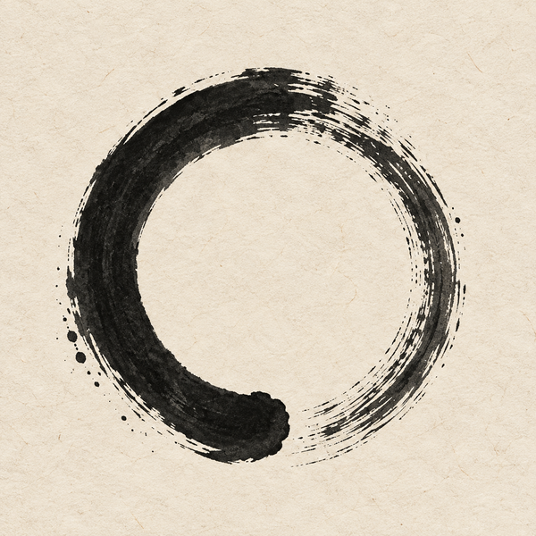
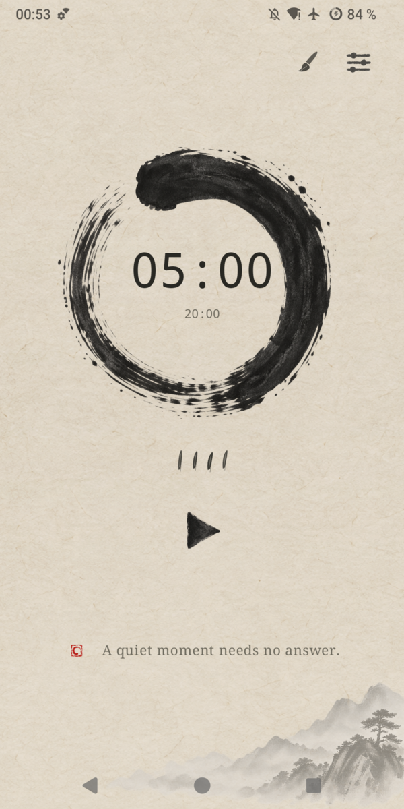

  

<h1 align="center">Enso</h1>

A quiet, offline meditation timer and interval gong for Android.

  
  
  

  

Enso is a minimal meditation timer built with Kotlin and Jetpack Compose. It runs entirely offline on Android 7.0+ (API 24), has no internet permission, accounts, analytics or ads, and is specified in [SPEC.md](docs/SPEC.md). The UI is portrait-only.

## What it does

- **Set any duration** from 5 minutes to 24 hours. Trace the ink circle clockwise to increase the duration, counterclockwise to decrease it. The ink follows your finger, stops at the duration limits and stays still during the countdown. Choose 1, 2, 5, 10 or 15 minutes per step in Settings (default: 5). The duration is saved after every adjustment.
- **Tap the circle to choose repetitions.** Left subtracts one, right adds one, down to 0 for unlimited repetitions. Small brush marks at a fixed distance below the circle show the repetitions; each completed countdown fades one mark from the right. A quiet elapsed / total time display inside the circle tracks finite sessions; unlimited sessions show elapsed / ∞ instead, alongside the larger hand-painted infinity mark below.
- **Paint your own Enso.** The brush opens a full-screen ink canvas with a faint guide circle and a textured sumi brush: width, ink flow, reach, bristle count, drag, speed influence and smoothing are tuneable in the slider panel and stored locally. Saving keeps the drawing in app-private storage, uses it in place of the standard artwork and shows a small painted mark on the brush button for the rest of the day; restore the standard Enso any time in normal mode. Unsaved drawings are temporary and are discarded if the drawing view closes or the activity is recreated.
- **A daily invitation.** On the first foreground visit of each local day without a saved drawing, the canvas opens on its own; closing it defers the invitation until tomorrow.
- **Hardcore Mode.** Turning it on opens the canvas after closing Settings, even if you already saved a drawing today. This requirement survives app restarts. The canvas offers only the checkmark that accepts the drawing; close, reset, restore and brush tuning are hidden, as is the main screen’s brush button. Once saved, the canvas stays unavailable until the next local day while the mode remains enabled. Turning it off restores every control; enabling it again requires a new drawing. Unsaved drafts remain temporary in this mode too.
- **English and German UI.** The visible interface, accessibility labels, notifications, gong names and sayings follow the system or per-app language; unsupported locales fall back to English.
- **Subtle selection feedback.** A soft click and short vibration mark each duration or repetition change. Switch both off with Haptic Feedback, independently of interval-end Vibration. Session buttons have no selection feedback.
- **One calm screen** for Start, Pause, Resume and Reset, using hand-drawn sumi ink controls with accessible action labels.
- **Choose your gongs.** Separate Start, End and Repeat gongs, each pickable from nine bundled bell recordings and previewable in the settings sheet.
- **Rotating sayings.** Twenty original Zen-inspired lines appear on launch, at the start of each session and at every repeated interval, with a soft fade and never an immediate repeat.
- **Simple preferences.** Keep Screen Awake, Vibration, Show Time and Show Saying apply immediately. Hide the time displays for a quiet circle with only the repetition brush marks. Gong sound preferences apply immediately; duration and repetition count stay locked until the session ends.

## License

[MIT](LICENSE)

The nine bundled gong recordings in `app/src/main/res/raw` come from [Pixabay](https://pixabay.com/) and are used under the [Pixabay Content License](https://pixabay.com/service/license-summary/), which requires no attribution. The adjustment tick is generated locally by `tools/generate_adjustment_tick.py` and contains no external samples.
